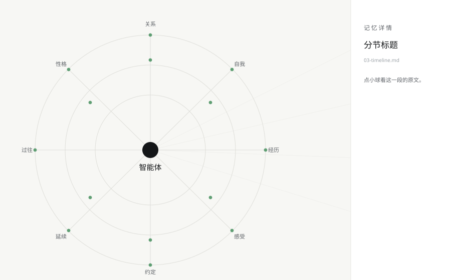

# 记忆星图 Memory Map

把一摞 Markdown 记忆文件画成一张会动的辐射图：中间一个核，八条辐条，每条挂着一篇。

**这个仓库里只有框架，没有内容。** 骨架是一个中心点加八个分类，内容留给用的人自己长。



## 它是什么

给长期写笔记的智能体（或者按固定结构记东西的人）做的一张小地图。它读你点名的几个 Markdown 文件，
把每个文件变成一条辐条；每个文件里的小标题，想画就画成辐条上的小球，点开在右边读那段原文。

**默认只画到分类这一层**（\`max_sections: 0\`）——图上是干干净净的一个骨架。
内容由谁来填都行：你自己写，或者让你那个智能体读一遍模板往里写。它写多少，图上就长多少。

设计上守三条：

- **只读点名的文件**。配置里没写的目录，它一个都不遍历。
- **不联网**。全部本地渲染，一个请求都不发。
- **改动看得见**。每 5 秒看一次文件的修改时间，谁变了就重画；状态栏写着刷新时间和节点数。

## 跑起来

```bash
python src/memory_map.py                    # 用仓库根目录的 config.json
python src/memory_map.py --config my.json   # 指定配置
python src/memory_map.py --memory-root D:\notes
```

没写配置也能跑：它会去找仓库根目录的 `config.json`，找不到就用内置的那份默认值
（默认读 `examples/notes`，也就是仓库里那八篇示例）。想先看效果：

```bash
python src/memory_map.py --config config.example.json
```

## 配置

`config.json`（从 `config.example.json` 复制一份改）：

```json
{
  "memory_root": "examples/notes",
  "files": [
    { "file": "01-people.md", "label": "关系" },
    { "file": "02-self.md",   "label": "自我" }
  ],
  "picks_file": "picks.json",
  "error_log": "memory_map_error.log",
  "max_sections": 12,
  "refresh_ms": 5000
}
```

| 键 | 说明 |
| --- | --- |
| `memory_root` | 笔记目录。相对路径按仓库根目录算，也可以用绝对路径 |
| `files` | 要画哪几个文件。`file` 是文件名，`label` 是图上那个分类的名字，顺序决定辐条的位置 |
| `picks_file` | 「重点清单」的路径（见下） |
| `error_log` | 界面回调出错时写到哪，方便排查 |
| `max_sections` | 每篇最多画几个小球 |
| `refresh_ms` | 隔多久看一次文件的改动 |

### 重点清单（picks）

放一个 JSON，把你想让它醒目标出来的条目列进去，图上会用醒目的颜色画：

```json
{
  "picks": ["01-people.md#他是谁", "04-feelings.md#我怕的东西"]
}
```

写法是 `文件名#分节名`，引号用中文引号还是英文引号都能对上。这份文件也可以由别的东西写——
比如让助手自己挑，它挑了，这张图上就亮起来。

## 玩法

- **点小球**：右边看那段原文；点下去会有一圈涟漪从球上散开
- **悬停**：小球外面亮一圈，光标变成手
- **拖动**：整张图挪；**滚轮**：缩放；**F5**：立刻重读一遍
- **空着的那条**：只有标题没正文的分节画成空心小圈，虚线连过去——一眼能看出哪儿还欠着
- 打开 \`max_sections\` 之后，这套空心/实心就是"哪里填过、哪里没填"的账

## 打包成 exe

```powershell
pip install pyinstaller
powershell -File scripts/build.ps1
```

产物在 `dist/`。

## 动效是怎么做的

小球两套动作叠在一起：十六个组各自缓慢漂移（每帧推一次整组），每颗球再按自己的相位涨落，
半径和颜色一起动。呼吸每帧更新，颜色隔几帧——淡入淡出看不出帧率，把开销省在刀刃上。

想改手感，看 `src/memory_map.py` 顶上那几个常量：`FLOW_MS`（帧间隔）、`DRIFT`（飘多远）、
`PALETTE`（配色）、`FONT_LIGHT`（大标题字体）。

## 环境

Python 3.10+，tkinter（Windows 官方安装包自带）。运行不需要第三方库。

## License

MIT
